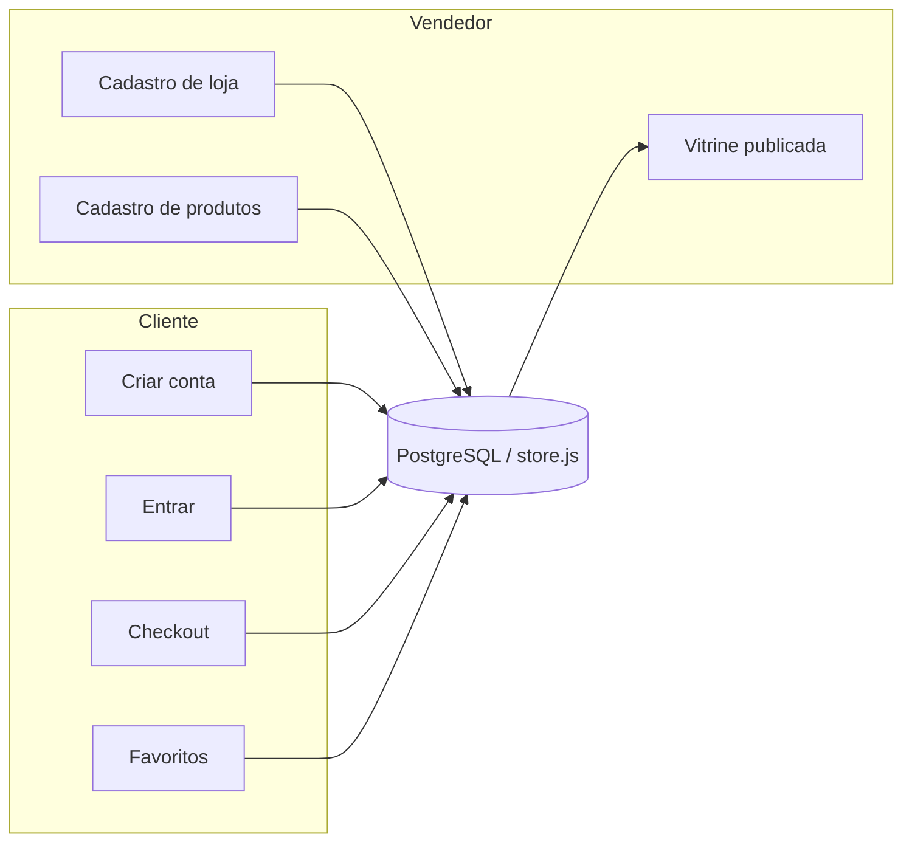

# Banco de dados ShopMix — jornadas de cliente e vendedor

Este documento descreve **como os dados fluem** do cadastro à vitrine. Conta, senha, carrinho, favoritos, loja, produtos e pedidos ficam no SQLite do servidor local (`data/shopmix.sqlite`, aberto por `npm start`). O navegador guarda uma cópia para abrir a página e envia as alterações para `PUT /api/workspace`. O Live Server usa esse mesmo banco quando o processo do `npm start` está no ar. O modelo PostgreSQL de produção continua em `database/schema.sql`.

## Visão geral

## Entidades principais

| Entidade | Finalidade |
| --- | --- |
| `profiles` | Pessoa (cliente, vendedor ou admin), credenciais e LGPD |
| `customer_profiles` | CEP/endereço padrão, opt-in marketing |
| `seller_applications` | Pedido de abertura de loja (CNPJ, categoria, análise) |
| `stores` | Loja aprovada, dono, reputação |
| `products` | Anúncios do vendedor + catálogo seed em `data.js` |
| `orders` / `order_items` | Compras com itens e endereço |
| `wishlists` | Favoritos por usuário |
| `audit_log` | Trilha de ações (cadastro, produto, pedido) |

## Jornada — cliente

1. **Criar conta** (`conta.html` → `registerCustomer`)
   - Nome, e-mail, senha (hash scrypt no servidor; o texto da senha não é gravado)
   - Telefone, CPF opcional, aceite de termos com timestamp
   - Cria `profiles` + `customer_profiles`

2. **Entrar** → sessão no servidor (`sessions`, cookie `HttpOnly`) e espelho em `shopmix.session` para a vitrine

3. **Checkout** → `orders` + `order_items` (itens, total, endereço)

4. **Favoritos / carrinho** → tabelas `cart_items` e `wish_items` no SQLite local, com cópia no navegador para a vitrine

## Jornada — vendedor

1. Usuário logado (recomendado) em **Vender no ShopMix**

2. **Cadastro de loja** → `seller_applications` + `stores`
   - Nome, CNPJ, categoria, sobre, contato, CEP fiscal
   - No protótipo: aprovação automática para liberar painel de produtos
   - Em produção: fila `pending` → revisão manual → `approved`

3. **Cadastro de produtos** → `products`
   - Campos mínimos: título, marca, categoria, preço, estoque, descrição, imagem
   - Status `published` entra na vitrine junto com o seed de `data.js`

4. **Catálogo** → `listPublishedProducts()` mesclado em `catalogProducts()` no front

## Arquivos de referência

| Arquivo | Papel |
| --- | --- |
| `database/schema.sql` | DDL Postgres de produção, incluindo `profiles` e `sessions` |
| `server/db.mjs` | Banco SQLite local: conta, senha, sessão e tabelas de comércio |
| `server/workspace.mjs` | Carrinho, favoritos, loja, produtos e pedidos por workspace |
| `server/index.mjs` | Servidor HTTP do site, `/api/auth/*` e `/api/workspace` |
| `public/js/api.js` | Descobre a API (mesmo site, Live Server ou `SHOPMIX_API_BASE`) e sincroniza o banco |
| `public/js/store.js` | Espelho da conta na vitrine |
| `public/js/data.js` | Catálogo demonstrativo (seed) |

## Próximo passo em produção (sugerido)

1. Apontar o mesmo contrato `/api/auth/*` para o Postgres de `database/schema.sql` quando houver servidor Postgres
2. Edge Function ou API para validação de CNPJ e antifraude
3. Storage bucket para upload de imagens (substituir URL manual)
4. Carrinho e favoritos já estão nas tabelas SQLite; no Postgres de produção, repetir `cart_items`, `wish_items`, `workspaces` e `devices`

## Exportação de dados (dev)

No console do navegador: `SHOPMIX_STORE.exportSnapshot()` retorna o JSON completo do banco local para auditoria ou migração.
