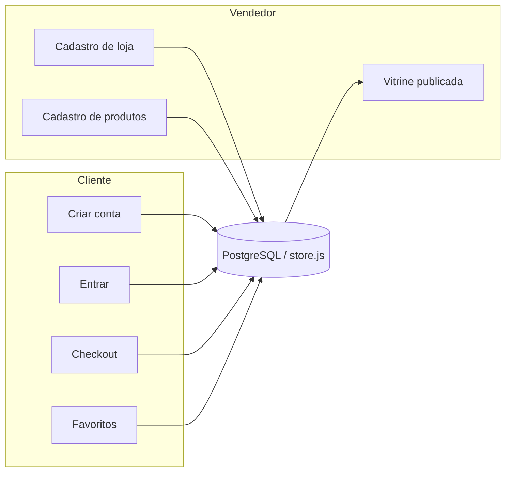

# Banco de dados ShopMix — jornadas de cliente e vendedor

Este documento descreve **como os dados fluem** do cadastro à vitrine, o modelo relacional de produção e a **camada local** (`public/js/store.js`) usada no protótipo enquanto o backend Postgres não está ligado.

## Visão geral

## Entidades principais

| Entidade | Finalidade |
| --- | --- |
| `profiles` | Pessoa (cliente, vendedor ou admin), credenciais e LGPD |
| `customer_profiles` | CEP/endereço padrão, opt-in marketing |
| `seller_applications` | Pedido de abertura de loja (CNPJ, categoria, análise) |
| `stores` | Loja aprovada, dono, reputação |
| `products` | Anúncios do vendedor + catálogo seed em `data.js` |
| `orders` / `order_items` | Compras com itens e endereço |
| `wishlists` | Favoritos por usuário |
| `audit_log` | Trilha de ações (cadastro, produto, pedido) |

## Jornada — cliente

1. **Criar conta** (`conta.html` → `registerCustomer`)
   - Nome, e-mail, senha (hash SHA-256 no protótipo; bcrypt/Argon2 em produção)
   - Telefone, CPF opcional, aceite de termos com timestamp
   - Cria `profiles` + `customer_profiles`

2. **Entrar** → sessão (`shopmix.session` local; JWT/Supabase Auth em produção)

3. **Checkout** → `orders` + `order_items` (itens, total, endereço)

4. **Favoritos / carrinho** → permanecem no navegador (`shopmix.cart`, `shopmix.wish`) até migrarmos para tabelas dedicadas

## Jornada — vendedor

1. Usuário logado (recomendado) em **Vender no ShopMix**

2. **Cadastro de loja** → `seller_applications` + `stores`
   - Nome, CNPJ, categoria, sobre, contato, CEP fiscal
   - No protótipo: aprovação automática para liberar painel de produtos
   - Em produção: fila `pending` → revisão manual → `approved`

3. **Cadastro de produtos** → `products`
   - Campos mínimos: título, marca, categoria, preço, estoque, descrição, imagem
   - Status `published` entra na vitrine junto com o seed de `data.js`

4. **Catálogo** → `listPublishedProducts()` mesclado em `catalogProducts()` no front

## Arquivos de referência

| Arquivo | Papel |
| --- | --- |
| `database/schema.sql` | DDL Postgres pronto para Supabase/Neon |
| `public/js/store.js` | Persistência estruturada no `localStorage` |
| `public/js/data.js` | Catálogo demonstrativo (seed) |

## Próximo passo em produção (sugerido)

1. Supabase Auth para e-mail/senha + RLS por `owner_user_id` em `stores` e `products`
2. Edge Function ou API para validação de CNPJ e antifraude
3. Storage bucket para upload de imagens (substituir URL manual)
4. Migrar carrinho/favoritos para tabelas quando houver login obrigatório

## Exportação de dados (dev)

No console do navegador: `SHOPMIX_STORE.exportSnapshot()` retorna o JSON completo do banco local para auditoria ou migração.
